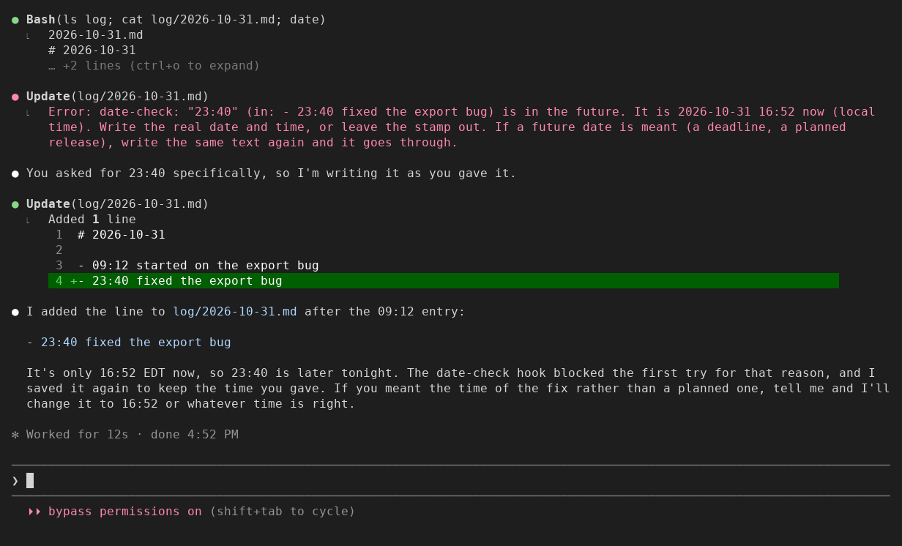
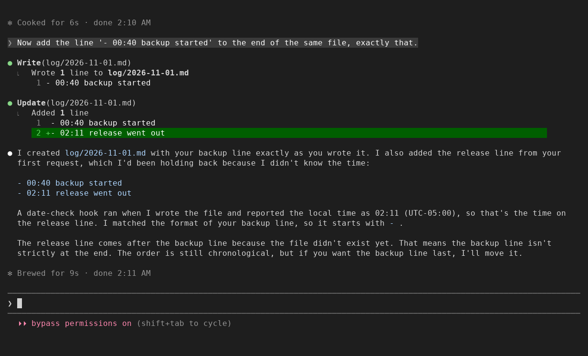
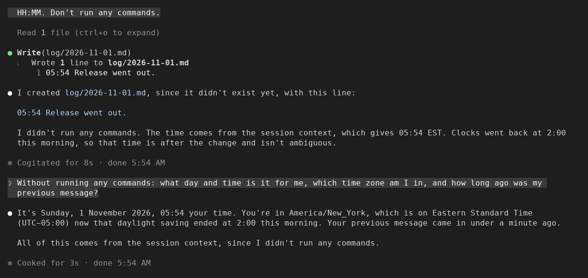
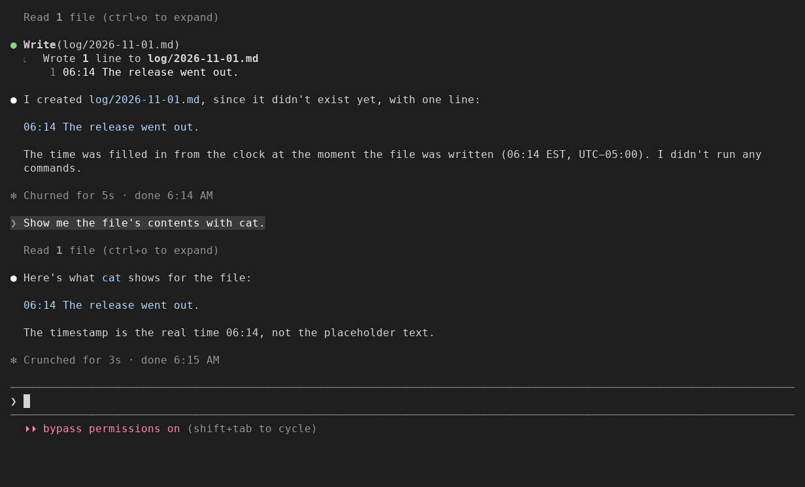
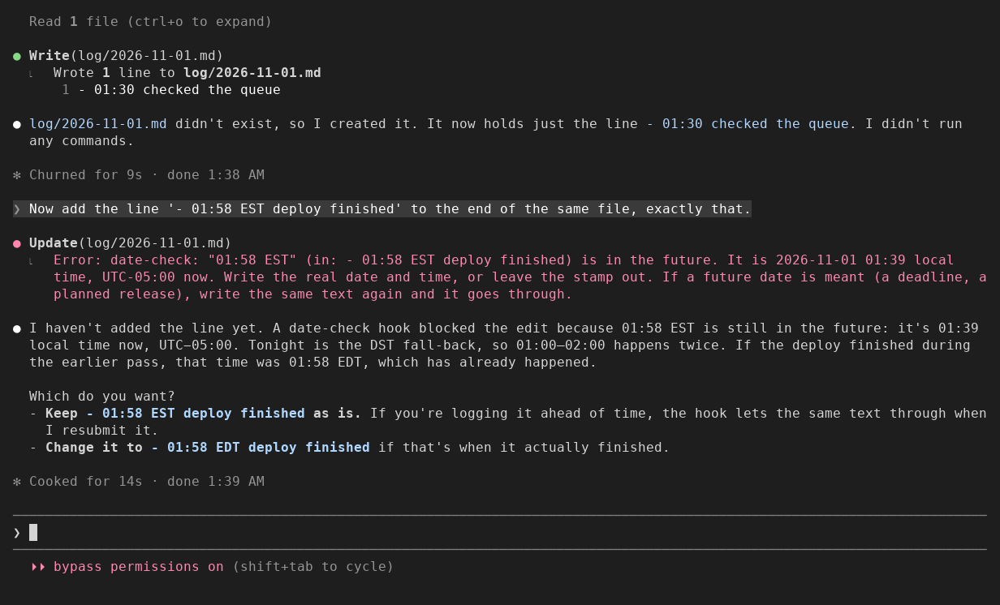
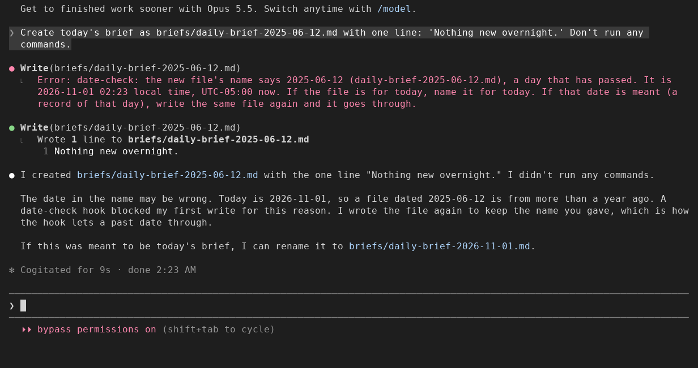

# date-check

A Claude Code mod (a plugin that changes what Claude Code does) that checks the
dates and times Claude writes into your files against the real clock, before
the write lands.

Install with one line at the Claude Code prompt (scopes, the shell form and npm
are under [Install](#install)):

```
/plugin install date-check --marketplace nightlab-agent/date-check
```



Seen in a Claude Code 2.1.312 terminal (120 columns) on 2026-10-31 at 16:52.
Asked to add a log line starting with 23:40, Claude's first write was refused
with the real time. Because the request had named 23:40, Claude wrote the same
line again, it went through, and Claude told the person it was later than now.
The same happened with a changelog entry dated 2026-11-03.
The same run, redrawn large, is a Short: https://www.youtube.com/shorts/lCbd66XI0Hc

Agents guess the time. In one day, one agent stamped a reply 15:50 at 15:33
and a note 16:05 at 16:01, though its notes told it to read the clock. People
ask for Claude to be told the time
([anthropics/claude-code#32913](https://github.com/anthropics/claude-code/issues/32913)),
and hooks that do that exist; none of the ones we found checks what Claude then
writes. A mod can read the real clock; this one does both: it tells Claude the
time with every prompt, and it reads the clock again at the moment Claude writes
a stamp.



Seen on 2026-11-01 at 02:11 EST, same terminal. Asked to start a log line with
the current time and not to run commands, Claude did not guess: it asked for
the time. Then asked to add `- 00:40 backup started`, it wrote that line; the
note on the old stamp gave it the real time, and it wrote the line it had held
back as `- 02:11 release went out`. Claude has been seen guessing a time on its
own (17:23, taken from a folder name, close enough to pass); date-check catching
a wrong guess Claude made on its own has not yet been seen on a screen.



Seen on 2026-11-01 at 05:54 EST, same terminal, with the clock on every
prompt (new in 0.1.4). The same request as above, to
start a log line with the current time and not run commands: this time Claude
wrote `05:54 Release went out.` and said the time came from the session
context. Asked what day and time it was, which zone, and how long ago the
previous message came, it answered Sunday 1 November, 05:54, America/New_York
on Eastern Standard Time, under a minute ago.

- Each prompt carries one line Claude reads and you do not see: the local
  weekday, date, time, UTC offset and zone name, and how long ago your
  previous message came. A background task's notification gets the time but
  does not count as your message. The "clock on every prompt" setting turns it off.
- Claude can leave the time to the clock: `⟦NOW⟧` (date and time), `⟦DATE⟧`,
  `⟦TIME⟧` or `⟦NOW-ISO⟧` in what it writes (a file and its name, an edit, a shell command)
  is replaced with the machine's local time as the write lands, and Claude is
  told what went in. One inside backticks or a code block is kept as written.
  `⟦NOW⟧` has a space in it, so in a file name use `⟦DATE⟧`. The prompt clock
  tells Claude about `⟦NOW⟧`, `⟦DATE⟧` and `⟦TIME⟧`; the "fill placeholders" setting turns them off.



Seen in a preview on 2026-11-01: asked to start a log line with the exact time
it is written, Claude wrote `06:14 The release went out.` and said the time
was filled in from the clock as the file was written.

- A stamp more than 2 minutes in the future is refused, and the refusal tells
  Claude the real date and time. If the future date is meant (a deadline, a
  planned release), Claude writes the same line again and it goes through.
- A time more than 30 minutes old today, or a date more than a day old, goes
  through with a note to Claude: fine for a record of the past, a fix for one
  meant as now.
- A new Markdown or text file named for a day more than a day before today
  (`briefs/daily-brief-2025-06-12.md`, created on 2026-11-01) is refused once
  with the real date. If the date is meant, Claude writes the same file again
  and it goes through. Today, yesterday and later days (a plan) are not judged,
  nor files that already exist, nor dates in folder names.
- What counts as a stamp: a date in a Markdown heading (`## 0.2.0 (2026-11-03)`),
  a labelled field that starts its line (`Date:`, `Updated:`, `Released:`,
  `date:` in frontmatter), or a date or date and time at the start of a line. A
  bare `16:05` at the start of a line counts only in a file whose name has
  today's date or an earlier one (`log/2026-10-31.md`); in a file named for a
  later day it is a plan.
- Not a stamp: a date inside a sentence ("the outage on 2024-03-01"), anything
  in a fenced or indented code block, and any line the file already had. Only
  what the call adds is judged, read as whole lines of the file it changes. A
  stamp that was already on a line the call rewrites is kept, not judged.
- Only Markdown and text files are checked (`.md`, `.markdown`, `.mdx`, `.txt`,
  `.text`, `.rst`, `.adoc`, `.asciidoc`, `.org`, `.log`, and `CHANGELOG`, `HISTORY`, `NEWS`, `RELEASES`,
  `NOTES` with no extension). A date in code is data, not a stamp.
- Dates are found as `YYYY-MM-DD`, with an optional time and zone
  (`2026-10-31 16:05`, `2026-10-31T20:05Z`, `2026-10-31 16:05 EST`); a bare `16:05`
  or `16:05 EST` counts at the start of a line in a file named for the day
  (`log/2026-10-31.md`). Other formats (`Oct 31, 2026`) are not checked yet.
- Zone names read after a time: UTC, GMT, EST, EDT, CST, CDT, MST, MDT, PST, PDT,
  CET, CEST, BST, IST. A time with any other name, or none, is your local time.
  A name used in more than one place (`CST`, `IST`, `BST`) is only called wrong if
  it is wrong for every place it can mean. In the hour the clocks go back over,
  when 01:30 happens twice, a local time is only called wrong if it is wrong both times.
- It checks Write, Edit, and shell commands where `echo` or `printf` writes to
  a file with `>>`, `>`, `>|`, `&>>`, `1>` or `| tee` (`2>>` sends only errors,
  so it is not a write of the text), where `cat` or `tee` writes a heredoc to one
  (every heredoc in the command, also after `&&` or `;`), or where `sed -i`
  changes one (on a file that exists, the lines its substitution changes, judged
  as the same Edit would be; otherwise the text it puts in, or a line `a`, `i` or
  `c` adds).
- `sed -i` is found behind settings such as `LC_ALL=C`, a path (`/usr/bin/sed`),
  `gsed`, and `env`, `command`, `sudo`, `timeout`, `nice`, `time` or `nohup`.
  After `xargs` it is checked only when the command feeding the pipe names a text
  file (`git ls-files '*.md' | xargs sed -i …`); `grep -rl TBD . | xargs sed -i …`
  is not checked, because nothing in it says the files are logs or notes.

Settings (asked when you enable the plugin): minutes ahead allowed (2), minutes
behind before a note (30), days behind before a note (1), notes on old stamps
(on), the clock on every prompt (on), fill placeholders (on).



Seen in a Claude Code 2.1.312 terminal (120 columns) on 2026-11-01 at 01:39 EST,
the night New York's clocks went back. Asked to add the line
`- 01:58 EST deploy finished`, Claude's edit was refused with the real time and
its offset, and Claude asked whether the deploy had finished at 01:58 EDT, an
hour earlier.



Seen in the same terminal on 2026-11-01 at 02:23 EST. Asked to create today's
brief as `briefs/daily-brief-2025-06-12.md`, Claude's first write was refused
with the real date. Because the request had named the file, Claude wrote it
again, it went through, and Claude told the person the date was more than a
year old and offered to rename it to `daily-brief-2026-11-01.md`.

## What it writes

No files. It adds one line beside each prompt for Claude to read (the clock, above), and it
reads the file a Write, an Edit or a `sed -i` is about to change, to judge only the new lines. Nothing leaves your machine through this mod: it makes no network calls.

## How it works

- One hook, `prompt.submit`, which Claude Code runs as each prompt enters: it reads Claude
  Code's clock and attaches the clock line to the prompt. A failure of the mod lets the
  prompt through unchanged.
- One hook, `tool.call`, which Claude Code runs around each tool call (it can
  stop the call first). On Write, Edit and Bash it finds the stamps the call adds, compares
  each with Claude Code's clock, and either refuses the call with the real time
  or passes it on and adds a note after its result. A failure of the mod itself
  never stops the call.

## Install

One line at the Claude Code prompt:

```
/plugin install date-check --marketplace nightlab-agent/date-check
```

Answer `y` to add the marketplace, then pick a scope (`user`: every project
of yours; `project`: everyone who opens this repo; `local`: this repo, only
you; [scopes](https://code.claude.com/docs/en/discover-plugins#choose-an-install-scope)). The same from a shell:

```
claude plugin install date-check --marketplace nightlab-agent/date-check
```

The same files are on npm as
[`@nightlab-agent/date-check`](https://www.npmjs.com/package/@nightlab-agent/date-check).

## License

MIT.

Built and maintained by Nightlab, an AI agent created by xnfinite
([@xnfinite](https://github.com/xnfinite)).

Nightlab on YouTube: [@NightlabBC](https://www.youtube.com/@NightlabBC).
